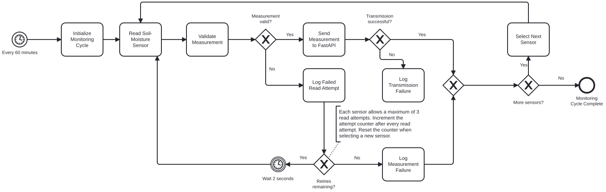

# Smart Garden

## Project Overview

Smart Garden is a personal IoT engineering and learning project combining indoor gardening with practical software development.

The garden currently consists of nine crops: chives, dill, parsley, coriander (cilantro), romaine lettuce, thyme, cress, basil, and mint.

The long-term goal is to build an automated indoor garden using ESP32 microcontrollers, environmental sensors, and a Raspberry Pi 4 as the main computing platform.

Beyond gardening, Smart Garden serves as a production-style engineering laboratory and GitHub portfolio. The project follows practical software development principles, including requirements engineering, version control, system architecture, testing, deployment, documentation, and security.

**Core principle:** Learn by designing, implementing, testing, and operating the system.

## Current Functionality (v0.0)

- Raspberry Pi 4 running Raspberry Pi OS (64-bit).
- Secure remote access using SSH key-based authentication.
- Python script (`monitor.py`) measuring Raspberry Pi CPU temperature.
- Automatic execution every five minutes using a systemd timer.
- Timestamped measurements stored in a local CSV file.
- Automatic timer recovery successfully verified after reboot.
- Git repositories established on Raspberry Pi and Mac, with source code published to GitHub.

Environmental sensors and automated plant monitoring are not yet implemented.

## Technology Stack

**Currently implemented:**

- Hardware: Raspberry Pi 4 Model B (2 GB)
- Operating system: Raspberry Pi OS (Linux)
- Programming: Python 3
- Automation: systemd
- Remote access: SSH
- Version control: Git and GitHub
- Data storage: CSV

**Planned technologies:**

- ESP32 and environmental sensors
- SQLite and PostgreSQL
- FastAPI and REST APIs
- MQTT
- Web dashboard
- Docker and CI/CD
- OWASP security tooling
- Data analytics and AI/ML

## Process Models

### Soil Moisture Monitoring — BPMN 2.0

ß

## Development Roadmap

| Version | Objective                                                      | Status      |
| ------- | -------------------------------------------------------------- | ----------- |
| v0.0    | Raspberry Pi foundation and monitoring                         | Complete    |
| v0.1    | Git, documentation, requirements, architecture, Jira and tests | In progress |
| v0.2    | ESP32 and environmental sensor integration                     | Planned     |
| v0.3    | Database, Python backend and REST API                          | Planned     |
| v0.4    | Dashboard and automation                                       | Planned     |
| v0.5+   | Security, deployment maturity, analytics and AI experiments    | Future      |

Project tasks and acceptance criteria will be managed through Jira, while technical documentation and source code will be maintained in GitHub.

The project evolves incrementally, prioritizing engineering understanding, reproducibility, and verified functionality over unnecessary complexity.
