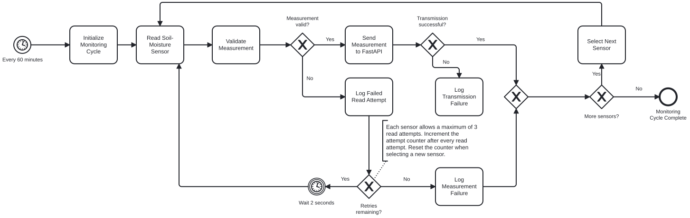
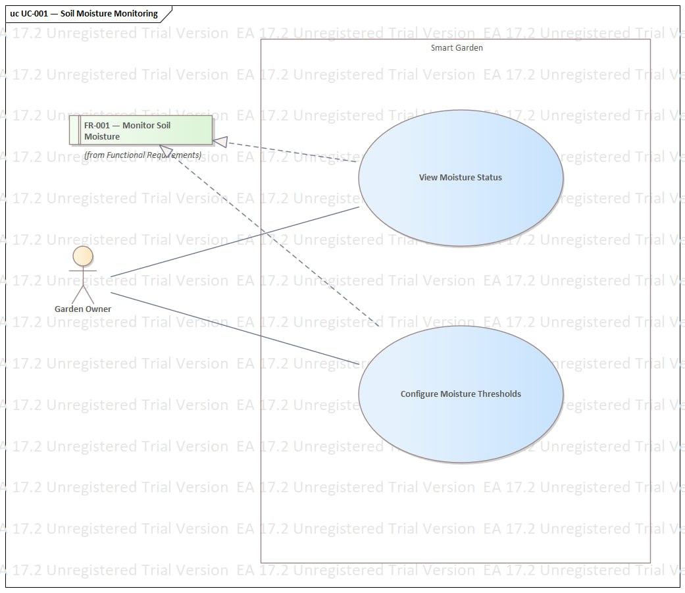

# Smart Garden

## Project Overview

Smart Garden is a personal IoT engineering and learning project combining indoor gardening with practical software development.

The garden currently consists of nine crops: chives, dill, parsley, coriander (cilantro), romaine lettuce, thyme, cress, basil, and mint.

The long-term goal is to build an automated indoor garden using ESP32 microcontrollers, environmental sensors, and a Raspberry Pi 4 as the main computing platform.

Beyond gardening, Smart Garden serves as a production-style engineering laboratory and GitHub portfolio. The project follows practical software development principles, including requirements engineering, version control, system architecture, testing, deployment, documentation, and security.

**Core principle:** Learn by designing, implementing, testing, and operating the system.

## Current Functionality (v0.0)

- Raspberry Pi 4 running Raspberry Pi OS (64-bit).
- Secure remote access using SSH key-based authentication.
- Python script (`monitor.py`) measuring Raspberry Pi CPU temperature.
- Automatic execution every five minutes using a systemd timer.
- Timestamped measurements stored in a local CSV file.
- Automatic timer recovery successfully verified after reboot.
- Git repositories established on Raspberry Pi and Mac, with source code published to GitHub.

Environmental sensors and automated plant monitoring are not yet implemented.

## Technology Stack

**Currently implemented:**

- Hardware: Raspberry Pi 4 Model B (2 GB)
- Operating system: Raspberry Pi OS (Linux)
- Programming: Python 3
- Automation: systemd
- Remote access: SSH
- Version control: Git and GitHub
- Data storage: CSV
- Backend: FastAPI
- API server: Uvicorn
- Automated testing: pytest and FastAPI TestClient
- Continuous integration: GitHub Actions

**Planned technologies:**

- Microcontrollers: ESP32
- Sensors: Capacitive soil moisture sensors, BH1750, BME280
- Hardware interfaces: I²C, SPI, ADC (MCP3008), CD74HC4067 multiplexer
- Data storage: PostgreSQL
- IoT communication: MQTT
- Backend extensions: REST APIs, sensor data ingestion and validation
- Frontend: Web dashboard (framework TBD)
- Data visualization: Sensor readings, historical trends and alerts
- Containerization: Docker
- Deployment: systemd services, automated deployment and rollback procedures
- Security: OWASP Threat Dragon, STRIDE threat modeling and security testing
- Infrastructure: Network segmentation, access controls and monitoring
- Testing: Integration, API and end-to-end testing
- Observability: Structured logging, metrics and health monitoring
- Automation: Sensor-based irrigation and lighting control
- Analytics: Historical data analysis and anomaly detection
- AI/ML: Predictive analytics and intelligent garden management (future scope)

## FastAPI Backend

Smart Garden includes a Python-based REST API built with FastAPI.

### Current Endpoints

### Current Endpoints

| Method | Endpoint      | Description                                             |
| ------ | ------------- | ------------------------------------------------------- |
| GET    | `/health`     | Returns the API health status                           |
| GET    | `/api/system` | Returns the latest recorded Raspberry Pi system metrics |

Example response:

```json
{
  "status": "ok"
}
```

### System Monitoring API

`GET /api/system` retrieves the latest CPU temperature
measurement from the existing `readings.csv` file.

Example response (HTTP 200):

```json
{
  "timestamp": "2026-11-02T19:05:00+01:00",
  "cpu": {
    "temperature_c": 31.2
  }
}
```

Error responses:

- HTTP 404: Monitoring data is missing or empty.
- HTTP 500: Stored monitoring data is invalid.

The API reads existing measurements without triggering
new hardware measurements. Data collection remains
the responsibility of the systemd-managed monitoring script.

Measurements are assumed to be appended chronologically.
The API returns the final recorded row.

### Local Development

Create and activate a Python virtual environment, then install dependencies:

```bash
python -m pip install -r requirements.txt
```

Start the development server:

```bash
python -m uvicorn app.main:app --reload --host 127.0.0.1
```

The API is available at:

- Health endpoint: http://127.0.0.1:8000/health
- Swagger UI: http://127.0.0.1:8000/docs

### Automated Tests

Run the complete test suite:

```bash
python -m pytest -v
```

Tests are also executed automatically through GitHub Actions
when changes are pushed to the main branch or submitted
through a pull request.

## Process Models

### Soil Moisture Monitoring — BPMN 2.0



## UML Models

### UC-001 — Soil Moisture Monitoring



The diagram documents the Garden Owner's interactions with
Smart Garden and traces the use cases to requirement FR-001.

The editable Enterprise Architect model is available at
[SmartGarden.qea](docs/uml/SmartGarden.qea).

## Development Roadmap

| Version | Objective                                                                   | Status      |
| ------- | --------------------------------------------------------------------------- | ----------- |
| v0.0    | Raspberry Pi setup, SSH access, CPU monitoring and systemd automation       | Complete    |
| v0.1    | Git, GitHub, requirements, architecture, BPMN/UML, Jira, pytest and CI      | Complete    |
| v0.2    | FastAPI backend, REST endpoints, CPU monitoring integration and API testing | In progress |
| v0.3    | Database integration, ESP32 connectivity and environmental sensors          | Planned     |
| v0.4    | Web dashboard, visualization and garden automation                          | Planned     |
| v0.5    | Security hardening, threat modeling, deployment and operational reliability | Future      |
| v0.6+   | Advanced analytics, AI/ML and intelligent garden management                 | Future      |

Project tasks and acceptance criteria will be managed through Jira, while technical documentation and source code will be maintained in GitHub.

The project evolves incrementally, prioritizing engineering understanding, reproducibility, and verified functionality over unnecessary complexity.
