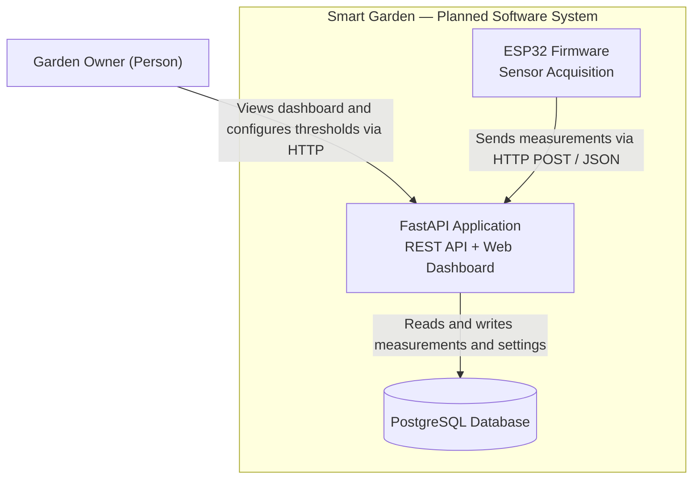

# C4 Level 2 — Container Architecture

**Status:** To-Be / Planned

## Container Diagram

## Design Decisions

- HTTP REST is the initial communication protocol between ESP32 and FastAPI.
- ESP32 uses bounded retries with temporary in-memory buffering.
- Measurements may be lost if the ESP32 restarts before successful delivery.
- Durable store-and-forward delivery is deferred.
- PostgreSQL is the primary relational database (ADR-0002).
- MQTT and store-and-forward delivery are deferred improvements.
- The MVP dashboard will be served by FastAPI. A separate frontend application is deferred.
