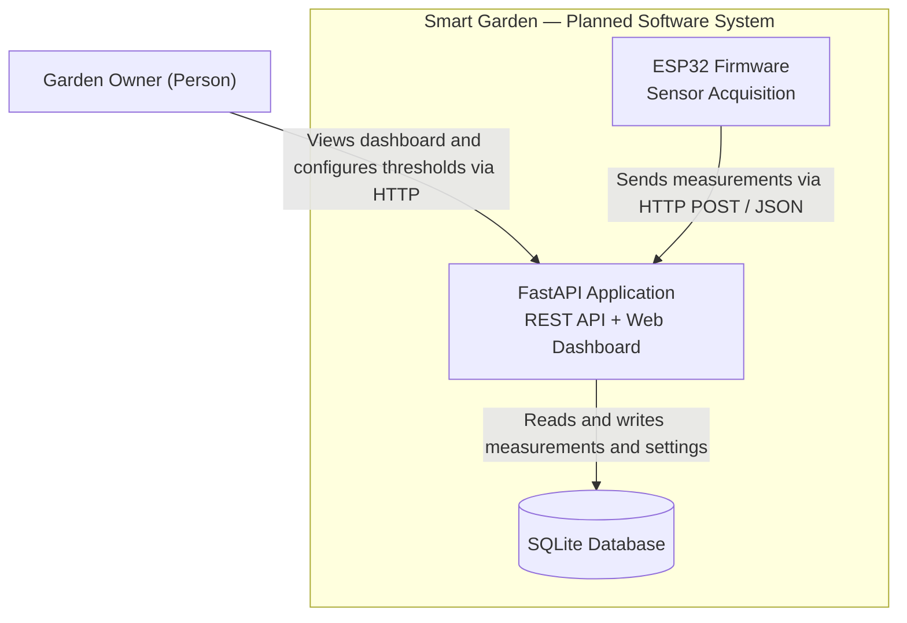

# C4 Level 2 — Container Architecture

**Status:** To-Be / Planned

## Container Diagram

## Design Decisions

- HTTP REST is the initial communication protocol between ESP32 and FastAPI.
- Sensor measurements use best-effort delivery without persistent buffering.
- SQLite is the initial database.
- MQTT and store-and-forward delivery are deferred improvements.
- The MVP dashboard will be served by FastAPI. A separate frontend application is deferred.
