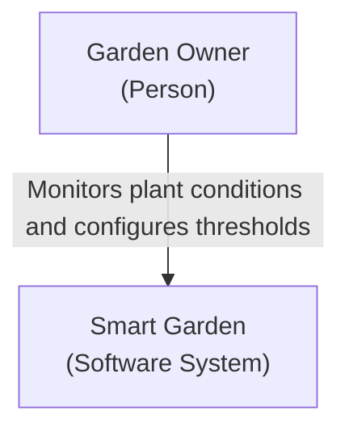

# C4 Level 1 — System Context

**Status:** To-Be / Planned

## Purpose

Smart Garden will monitor indoor plant conditions and present
measurements and watering status to the garden owner.

## System Context

## Scope Notes

- This diagram represents the planned software system.
- Raspberry Pi, ESP32 and sensors are internal implementation details.
- Sonoff/eWeLink integration is not yet included in this scope.
- GitHub is development infrastructure, not an operational dependency.
